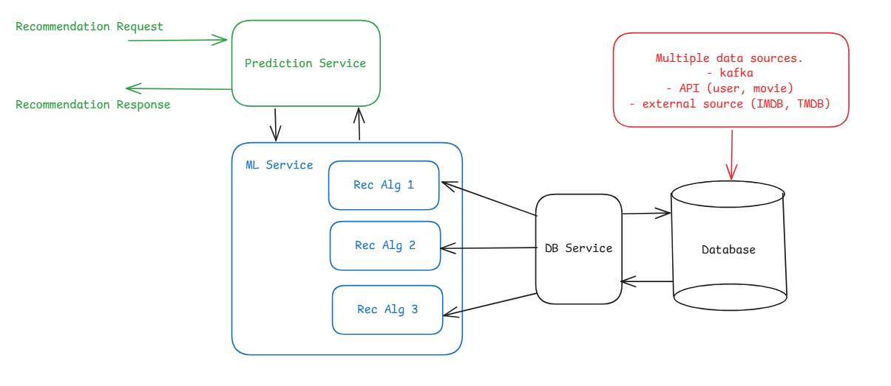

# Team Home Alone's Movie Recommendation System
This is a course project built for Machine Learning in Production (17645). The goal of the project is to build a movie recommendation system.

## Project Overview
At a very high level, the project consists of the 3 parts:
- Data system: This system consists of components that fetch data from multiple sources, process the data into system-defined formats and store in a database.
- Recommender system: This system consists of components that fetch raw data from the database, process the data into features (and store such features), train and serve recommender models.
- API system: This system exposes an API service that uses the Recommender system to make movie recommendations for users.

Below is a high level system overview:


## Project Setup

1. Clone the repository `git clone https://github.com/cmu-seai/group-project-f25-home-alone.git home-alone`
2. `cd home-alone`
3. Create a virtual environment with your favorite package manager (pip, conda etc). We recommend using anaconda like so: `conda create --name <env-name> python=3.11`.
4. Activate the virtual environment like so: `conda activate <env-name>`
5. Install the dependencies using `pip install -r requirements.txt`. Followed by `pip install -e .`
6. Create a `.env` at the root of the project with the following variables.
```
TUNNEL_IP=<kafka_IP>
TUNNEL_PORT=<kafka_port>
TUNNEL_USER=<kafka_username>
TUNNEL_PASSWORD=<kafka_password>
DATA_QUEUE_DIR=<output_dir>
DB_PATH=<db_dir>
```

## Data System

You need to run the components of this system to get data required to train the Recommendation System. Follow the steps below to fetch data.

1. Run `python src/data_processing/process.py`. This connects to the Kafka data stream and begins reading from it. The read data is saved to temporary csv files.
2. In parallel, run `python src/data_processing/cron_job.py`. This periodically (every 5 minutes) saves the csv files in the data and deletes them after.
3. Leave steps 1 and 2 running as long as you want (depending on the amount of data you want to collect). When done, you can view the contents of the database using the `DBReader()` like so `python src/data_processing/db_writer.py`. 

    For in-program usage, see lines 51-54
    ```
        reader = DBReader()
        print(reader.get_watch_history())
        print(reader.get_ratings())
        reader.close()
    ```
4. TODO: add instructions for fetching movie data.

## Recommender System

Everything related to this system is found in the `src/models` folder. This system is made of 4 different recommendation models (Collaborative Filtering, Content-based Filtering, UBCF and Deep-learning-based Recommendation). Each of these models implement a base recommender class (`Recommender`) and provide `train()` and `recommend(user_id)` methods for usage.

To train any model run `python src/models/train.py <model_type>` where `<model_type>` is one of `[CF, CB, UBCF, DL]`.

After training, you can test recommendation like so: `python src/models/recommend.py <model_type> <user_id>` where `<model_type>` is one of `[CF, CB, UBCF, DL]` and `<user_id>` is any valid user_id.


### Recommendation Factory
The recommender system also includes a `RecommenderFactory` that lets developers switch between model types easily using an `RecommenderModelType` enum. The available enums are listed below:

```
RecommenderModelType.COLLABORATIVE_FILTERING
RecommenderModelType.CONTENT_BASED
RecommenderModelType.UBCF
RecommenderModelType.DEEP_LEARNING
```

See `src/api/app.py` lines 14-32 for usage.

## API System
This system exposes our recommendation service to the public for usage built using `flask`. 

To run the server locally on port 8082, run: `python src/api/app.py`.

Test API using curl, postman, thunderclient etc (The choice is yours)

